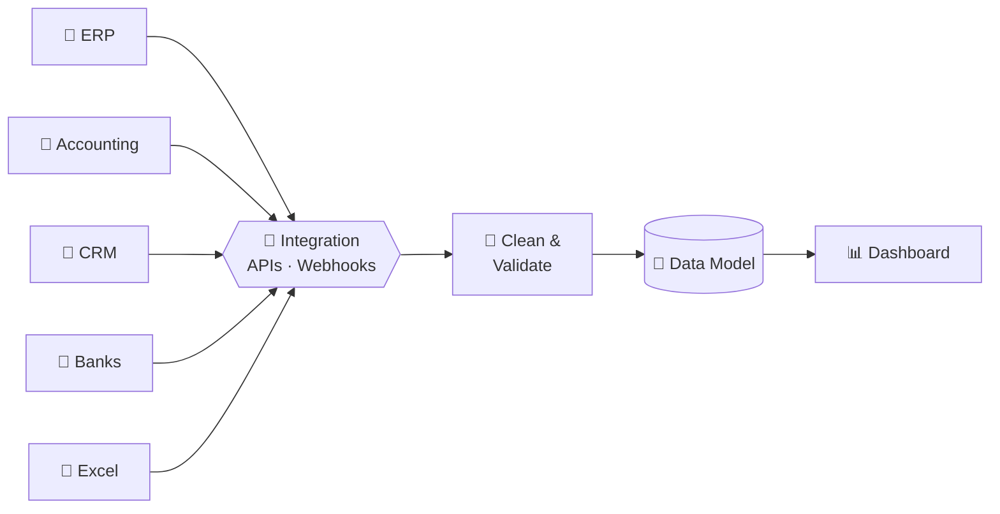

  

  

  
  

  
  
  

---

### 👋 About me

I started in **accounting and tax**, then moved into **business intelligence, ERP and automation**. That mix means I build systems that both the finance team and the auditors trust.

I work with **multi-company groups in Egypt and Saudi Arabia**, handling multiple entities, currencies and tax regimes, including **ZATCA e-invoicing**.

### 🛠️ What I do

| | |
|---|---|
| 🏗️ **ERP implementation** | Multi-company setups, inter-company flows, approvals, permissions and tax compliance |
| 🔄 **Data migration** | Moving between platforms with full history, reconciled line by line |
| 🔗 **Integration** | Connecting ERP, CRM, accounting, banks and Excel through APIs and scheduled syncs |
| ⚙️ **Automation** | Approvals, notifications, email routing and system-to-system sync |
| 📊 **BI dashboards** | Consolidated P&L, cash, receivables and KPIs across companies and currencies |
| 🧩 **Custom apps** | Modules for budgeting, treasury, workflow tracking, reporting and HR |

### 🔁 How data flows in my projects

### 🧰 Tech stack

  
  
  
  
  
  
  
  
  
  
  
  
  

### 📈 GitHub activity

  
  

  

